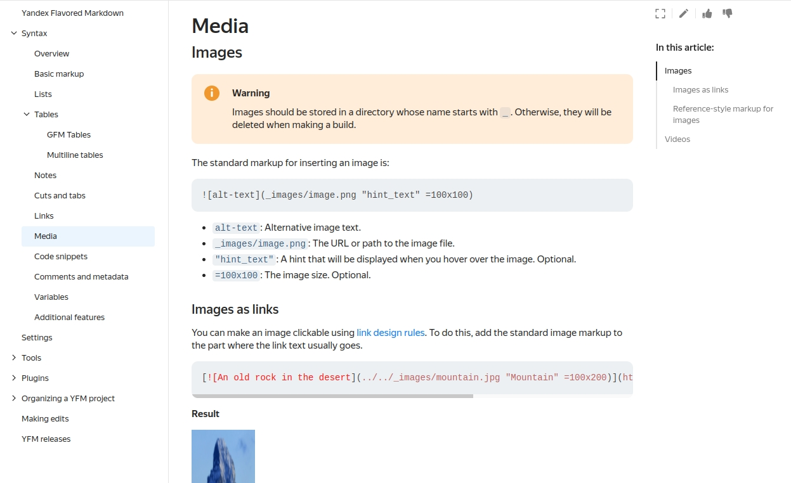

**english** | [русский](https://github.com/diplodoc-platform/cli/blob/master/README.ru.md)

---

[](https://www.npmjs.org/package/@diplodoc/cli)
[](https://sonarcloud.io/summary/new_code?id=diplodoc-platform_cli)
[](https://sonarcloud.io/summary/new_code?id=diplodoc-platform_cli)
[](https://sonarcloud.io/summary/new_code?id=diplodoc-platform_cli)
[](https://sonarcloud.io/summary/new_code?id=diplodoc-platform_cli)
[](https://sonarcloud.io/summary/new_code?id=diplodoc-platform_cli)

# yfm-docs

Yfm-docs lets you build a full-fledged documentation project: with navigation, internal transitions, and full
[Yandex Flavored Markdown (YFM)](https://diplodoc.com/docs/en/index-yfm) support.



## Documentation

To export resolved documentation as backend-neutral JSON for external indexing, see
[Search corpus export](docs/search-index.md).

[ydocs.tech](https://diplodoc.com/docs/en/tools/docs)

## Requirements

Node 22+

## Usage

```bash
npm i @diplodoc/cli -g
```

```bash
npm run start -- -i ./input-folder -o ./output-folder -v "{\"name\":\"Alice\"}"
```

## Article dates in build manifests

Markdown builds emit `yfm-build-manifest.json` by default. With `mtimes` enabled,
the manifest includes `pageModifiedTimes`, a map from source page paths without
their final extension to UTC ISO modification timestamps. Dates use finalized
page metadata, including changes to included content. Keys retain forward slashes
on every platform. Sequential builds and builds using `--jobs` export the same
dates; worker results carry the already finalized timestamps to the manifest.

The map is absent when `mtimes` is disabled. An empty map means no article dates
are available. Consumers must omit dates for missing entries instead of assigning
the project revision date. A compatible documentation viewer uses this map to
populate article `<lastmod>` tags in `sitemap.xml`.

## `yfm init`

Initialize a new Diplodoc documentation project.

### Usage

```bash
yfm init [options]
```

Running without flags in a terminal starts an interactive wizard. Pass `--skip-interactive` to use flags and defaults only.

### Options

| Option                    | Default            | Description                                       |
| ------------------------- | ------------------ | ------------------------------------------------- |
| `-o, --output <path>`     | `.`                | Directory to create the project in                |
| `--name <string>`         | directory basename | Project name                                      |
| `--langs <string>`        | `en`               | Comma-separated list of languages, e.g. `en,ru`   |
| `--default-lang <string>` | first of `--langs` | Default language                                  |
| `--template <string>`     | `minimal`          | `minimal` or `full`                               |
| `--header`                | `true`             | Add navigation header with controls to `toc.yaml` |
| `--force`                 | `false`            | Overwrite existing output directory               |
| `--dry-run`               | `false`            | Preview files without writing                     |
| `--skip-interactive`      | `false`            | Skip wizard                                       |

### Created files

**`minimal`**

```
<output>/
├── .yfm
├── toc.yaml
└── index.md
```

**`full`** — adds `presets.yaml`, `pc.yaml` and extended `.yfm` with pdf, search, vcs, authors config.

For multilingual projects (`--langs en,ru`) content is placed in per-language subdirectories:

```
<output>/
├── .yfm
├── presets.yaml
├── en/
│   ├── toc.yaml
│   └── index.md
└── ru/
    ├── toc.yaml
    └── index.md
```

## `yfm generate metadata`

Generate metadata in Markdown frontmatter or the `meta` block of YAML leading and
Page Constructor pages, using the AI clients from `translate`. Directory input
recursively includes `.md`, `.yaml` and `.yml`; hidden directories, `node_modules`,
`_includes`, TOCs, presets and YAML without `links` or `blocks` are skipped.

```bash
export YANDEX_API_KEY='<api-key>'
yfm generate metadata -i ./docs
yfm generate metadata -i ./docs/article.md --folder <folder-id> \
  --fields title,description,summary,tags --skip-interactive
```

The wizard runs in a terminal unless `--skip-interactive` is set. It lists all
AJV frontmatter fields with nothing selected, even when flags or config specify fields;
select at least one field to continue. In non-interactive runs, flags override
`generate.metadata` in `.yfm`. Directory input discovers `.yfm` automatically;
for a single file, pass `-c ./docs/.yfm` explicitly:

```yaml
generate:
  metadata:
    fields: [title, description, summary, tags]
    mode: missing
    provider: openai
    model: gpt-4o-mini
```

Authentication follows `translate`: `--auth` accepts a token or token-file path;
otherwise use `YANDEX_API_KEY` / `YC_IAM_TOKEN`, `OPENAI_API_KEY`,
`OPENROUTER_API_KEY` or `ANTHROPIC_API_KEY`. Never store `auth` in `.yfm`.
YandexGPT needs a folder ID unless `--model` is a full `gpt://` or `ds://` URI.
The wizard asks for it when needed, using `--folder` or `generate.metadata.folder`
as the default. For non-interactive runs, set the folder through that flag or config.
Gateways support `--api-base` and repeated `--api-header 'Name: value'`
(`apiHeaders` in config); an authorization header can replace `--auth`.
`OPENAI_BASE_URL`, `OPENROUTER_BASE_URL` and `ANTHROPIC_BASE_URL` are also supported.

Without `--fields` or `generate.metadata.fields`, non-interactive runs select
`title`, `description`, `summary`, `keywords` and `tags`. Explicit selection accepts
any AJV frontmatter field. Only the five descriptive fields can change; other
publication settings must be omitted or exactly match existing values if returned
by AI. Matching settings are not rewritten; changed or invented settings reject
the response. The response schema rejects unselected keys. Prefer the five-field
default for generation: broad selections can cause unnecessary validation retries.
Review descriptions for accuracy and natural wording; validation cannot assess
writing quality.

`missing` adds absent keys, preserving existing `false`, `null` and empty strings.
`overwrite` replaces selected descriptive fields returned by AI. YAML comments,
unselected values and Markdown content are retained; YAML formatting may change.
Frontmatter delimiters of three or more hyphens are preserved. Initial Markdown
BOM is removed so the build recognizes frontmatter; ambiguous strings are quoted.
Before saving, the build's YAML parser verifies generated values and unchanged
content, including indirect changes through anchors/aliases. Concurrent file edits
also prevent saving. Liquid in YAML or an aliased page `meta` block causes an error
before any AI request; Liquid in the Markdown body is preserved. Includes and
variables are not expanded.

Responses must pass AJV type, format and length checks. `summary` must end with
sentence punctuation, without an ellipsis; the prompt targets 60–80 characters
within the 100-character limit. Control characters are rejected, except tabs and
line breaks in multiline values. YandexGPT uses ordinary JSON text because its
constrained decoding corrupted strings in live checks. Invalid responses are
retried with validation feedback; transient API errors are also retried.
A failed file stays unchanged and stops the command with a nonzero exit code;
previously completed files remain saved. Files needing no changes make no AI call.

| Option                    | Default                       | Description                                      |
| ------------------------- | ----------------------------- | ------------------------------------------------ |
| `-i, --input <path>`      | `.`                           | Documentation file or directory                  |
| `--fields <list>`         | all five descriptive fields   | Comma-separated fields; wizard starts unselected |
| `--mode <mode>`           | `missing`                     | `missing` or `overwrite`                         |
| `--provider <provider>`   | `yandexgpt`                   | `yandexgpt`, `openai`, `openrouter`, `anthropic` |
| `--model <name>`          | same as `translate`           | Model name                                       |
| `--auth <value>`          | provider environment variable | Token or token-file path                         |
| `--folder <value>`        | —                             | Yandex AI Studio folder                          |
| `--api-base <url>`        | provider endpoint             | Override API base URL                            |
| `--api-header <header>`   | —                             | Additional HTTP header; repeatable               |
| `--timeout <ms>`          | `60000`                       | Request timeout                                  |
| `--max-output-tokens <n>` | `4000`                        | Maximum response tokens                          |
| `--retry <n>`             | `3`                           | Invalid-response and API-error retries           |
| `--rate-limit-retry <n>`  | `8`                           | Separate retry budget for rate limits            |
| `--skip-interactive`      | `false`                       | Skip the wizard                                  |

Run `yfm generate` to see the available generation commands.

## `yfm content`

Process a **single** Markdown file and print the result to stdout (or write it to a file).
Unlike `yfm build`, it does not traverse the whole project and does not produce a full page —
for `html` it emits only the **content fragment** (no toc, header or page chrome).

### Usage

```bash
# self-contained markdown to stdout
yfm content -i ./page.md -f md

# html content fragment into a file
yfm content -i ./page.md -f html -o ./page.html
```

The result printed to stdout is wrapped in delimiter markers so it can be extracted from the
surrounding diagnostic output:

```
<<<<<< YFM CONTENT START >>>>>>
...content...
<<<<<< YFM CONTENT END >>>>>>
```

Warnings and errors go to stderr; on any build error the process exits with a non-zero code.
When `-o` is used, the raw content is written to the file (without the markers).

Pass `--raw` to print **only** the content to stdout — without the delimiter markers and
without the framework banners (version line, build timer, completion banner). This is handy
when piping the result straight to another tool or file:

```bash
yfm content -i ./page.md -f md --raw > page.md
```

`--raw` has no effect together with `-o` (file output is always raw).

### Project root

Presets (`presets.yaml`), includes and variables are resolved relative to a project root:

- by default the root is the **current working directory**;
- pass `-c, --config <path>` to point at a `.yfm` — its directory becomes the root.

### Options

| Option                                   | Default   | Description                                               |
| ---------------------------------------- | --------- | --------------------------------------------------------- |
| `-i, --input <file>`                     | —         | Path to the Markdown file to process (required)           |
| `-o, --output <file>`                    | stdout    | Write the result to a file instead of stdout              |
| `-f, --output-format <md\|html>`         | `html`    | Output format                                             |
| `-w, --watch`                            | `false`   | Re-render on changes to the file, its includes & presets  |
| `--raw`                                  | `false`   | Print only the content to stdout (no markers, no banners) |
| `-c, --config <path>`                    | `.yfm`    | Config file; its directory becomes the project root       |
| `--vars-preset <name>`                   | `default` | Variables preset to apply                                 |
| `-v, --vars <json>`                      | —         | Inline variables (JSON) overriding presets                |
| `--allow-html` / `--no-allow-html`       | `true`    | Allow raw HTML in Markdown                                |
| `--sanitize-html` / `--no-sanitize-html` | `true`    | Sanitize the produced HTML                                |
| `--id-generator <strategy>`              | `random`  | Element id strategy: `random`, `deterministic`, etc.      |
| `-s, --strict`                           | `false`   | Exit with a non-zero code on warnings                     |

### Legacy code selector notices

The legacy `` selector remains supported.
It emits an informational `INFO` notice recommending named regions. This notice
does not fail a `--strict` build and is hidden by `--quiet`. Other warnings, including
missing substring markers and ignored directive attributes, still fail strict builds.

Code paths may contain literal `#` characters, for example `./C#/Program.cs`.
Normally, the complete existing file path takes precedence. Only when it does not name a
file is the final `#` interpreted as a named-region selector, so
`./C#/Program#v2.cs#auth` selects `auth` from `./C#/Program#v2.cs`.
Suffixes after the final `#` with `/./` or `/../` segments (including a trailing
`/.` or `/..`) are treated as region names without probing a literal path. These
segments are never normalized as part of the file path.

Hash region markers require a space, tab, end of line or block-comment terminator
after `#region` or `#endregion`. Text such as `#region-banner` or `#endregion-old`
remains ordinary source text.

### Local anchor diagnostics

HTML builds report a missing local link anchor as `YFM025 / missing-local-anchor`. It is a
warning by default, including when an existing `.yfmlint` config sets `YFM002` to `error`.
Missing or unreachable target documents still produce `YFM003` errors.

Literal browser fragment directives such as `#:~:text=Selected%20text` and
`#section:~:text=Selected%20text` are excluded from local-anchor validation. The
target document is still checked. Percent-encoded literal IDs remain subject to
ordinary anchor validation.

Configure the new rule independently in `.yfmlint`:

```yaml
YFM025: warn
```

Use `YFM025: error` to fail builds on missing local anchors or `YFM025: false` to disable
the check. `--strict` continues to fail builds on warnings.

`YFM024 / empty-custom-heading-anchor` belongs to yfmlint and reports an empty
shorthand heading ID, for example `{# section-id}`. It is independent of the
CLI-only `YFM025` check: severity settings and inline suppression apply separately.
If a configuration adopted the temporary CLI-master `YFM024` local-anchor check,
use `YFM025` or the unchanged `missing-local-anchor` alias for that check instead.

## Source files

### Preparation

You need to add `.env` file into repo root with data below:

```bash
GITHUB_OWNER=
GITHUB_REPO= # docs
GITHUB_TOKEN= # personal access token
GITHUB_BASE_URL= # for ex: https://api.github.com
VCS_CONNECTOR_TYPE= # github
```

or you can update .yfm file into docs repo

```bash
connector:
    type:
    github:
        endpoint:
        token:
        owner:
        repo:
```

### Build from source

```bash
cd cli
npm ci && npm run build
```

## License

MIT
